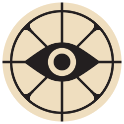
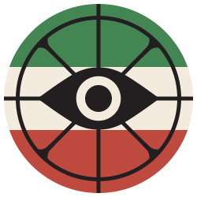

# DeadlockPersianAssets

[English](#english) | [فارسی](#فارسی)

<p align="center">
  
  &nbsp;&nbsp;&nbsp;&nbsp;
  
</p>

Vector logo assets for Deadlock: the original game logo and a Persian variant made for the Deadlock Persian community, plus an interactive animated version and a reproducible export pipeline (optimized SVGs + PNG icon sets).

## English

### Variants

| File | Description |
|---|---|
| `exports/deadlock.svg` | The original game logo |
| `exports/deadlockpersian.svg` | Made for the Deadlock Persian community |
| `exports/*-animated.svg` | Interactive versions: the frame rotates and the eye responds on hover/focus/touch |
| `exports/<variant>/NNN.png` | Raster icons: 16–2048 px |
| `exports/*-preview.html` | Standalone demo pages for the animated versions |

> GitHub sanitizes `<script>` in rendered files, so animated SVGs appear static here. Open a `-preview.html` file locally (or embed the animated SVG in your site) to see the motion.

### Usage

The animated logo exposes a small API on its root element:

```js
document.querySelector('#svg1').setDeadlockActive(true);  // start rotating
document.querySelector('#svg1').setDeadlockActive(false); // settle at next quadrant
```

Hover, focus and touch are wired up automatically inside the SVG. `prefers-reduced-motion` is respected.

### Rebuilding

Sources live in [`inkscape/`](inkscape/) (editable Inkscape files); [`exports/`](exports/) is generated.

```bash
python -m venv .venv
. .venv/bin/activate        # Windows: .venv\Scripts\activate
pip install -r requirements.txt

python export.py    # inkscape/*.svg -> exports/: optimized SVGs + PNG sets
python animate.py   # exports/*.svg  -> *-animated.svg + *-preview.html
```

Requirements: Python 3.8+, [Inkscape](https://inkscape.org/) (only for editing the sources).

### Editing the sources

1. Edit `inkscape/*.svg` in Inkscape; layers and guides are labeled and locked.
2. Saving from Inkscape re-adds workspace metadata; run `python clean.py` to strip it (guides, labels and ids are preserved).
3. Re-run `export.py` and `animate.py` to refresh `exports/`.

### License

This work is dedicated to the public domain via [CC0 1.0](LICENSE): no rights reserved, no attribution required.

### Disclaimer

"Deadlock" and the original game logo are property of Valve. This project is unofficial and claims no affiliation with or endorsement by Valve. CC0 applies only to the original work in this repository: the Persian community variant, the animated SVGs and the build scripts.

## فارسی

<div dir="rtl" align="right">

دارایی‌های لوگوی وکتور ددلاک: لوگوی اورجینال خود بازی و نسخه‌ی فارسیِ ساخته‌شده برای کامیونیتی ددلاک پرشین، به‌همراه نسخه‌ی متحرک تعاملی و خط تولید خروجی قابل‌تکرار (SVG بهینه + آیکون‌های PNG).

### نسخه‌ها

| فایل | توضیح |
|---|---|
| `exports/deadlock.svg` | لوگوی اورجینال خود بازی |
| `exports/deadlockpersian.svg` | ساخته‌شده برای کامیونیتی ددلاک پرشین |
| `exports/*-animated.svg` | نسخه‌های تعاملی؛ قاب می‌چرخد و چشم به هاور/فوکوس/لمس واکنش نشان می‌دهد |
| `exports/<variant>/NNN.png` | آیکون‌های پیکسلی: ۱۶ تا ۲۰۴۸ پیکسل |
| `exports/*-preview.html` | صفحه‌ی نمایش مستقل نسخه‌های متحرک |

> گیت‌هاب تگ `<script>` را هنگام نمایش حذف می‌کند و نسخه‌های متحرک اینجا ایستا دیده می‌شوند. برای دیدن حرکت، یکی از فایل‌های `-preview.html` را محلی باز کنید یا SVG متحرک را در سایت خودتان قرار دهید.

### استفاده

نسخه‌ی متحرک یک API کوچک روی عنصر ریشه دارد:

```js
document.querySelector('#svg1').setDeadlockActive(true);  // شروع چرخش
document.querySelector('#svg1').setDeadlockActive(false); // توقف در ادامه‌ی ربع بعدی
```

هاور، فوکوس و لمس داخل خود SVG مدیریت می‌شوند و `prefers-reduced-motion` هم رعایت می‌شود.

### بازسازی خروجی‌ها

فایل‌های مادر در پوشه‌ی [`inkscape/`](inkscape/) هستند (قابل‌ویرایش در Inkscape) و [`exports/`](exports/) ساخته‌شده است:

```bash
python -m venv .venv
. .venv/bin/activate
pip install -r requirements.txt

python export.py    # خروجی SVG بهینه + ست PNG
python animate.py   # ساخت نسخه‌ی متحرک + صفحه‌ی پیش‌نمایش
```

پیش‌نیازها: پایتون ۳.۸ به بالا و [Inkscape](https://inkscape.org/) (فقط برای ویرایش سورس‌ها).

### ویرایش سورس‌ها

1. فایل‌های `inkscape/*.svg` را در Inkscape ویرایش کنید؛ لایه‌ها و راهنماها نام‌گذاری و قفل شده‌اند.
2. ذخیره‌ی Inkscape دوباره metadataهای میزکار اضافه می‌کند؛ برای پاک‌سازی `python clean.py` را اجرا کنید (راهنماها، لیبل‌ها و idها دست‌نخورده می‌مانند).
3. برای به‌روزرسانی `exports/`، دوباره `export.py` و `animate.py` را اجرا کنید.

### مجوز

این اثر با [CC0 1.0](LICENSE) به مالکیت عمومی اختصاص یافته؛ بدون هیچ حقی محفوظ و بدون نیاز به ذکر منبع.

### سلب مسئولیت

«ددلاک» و لوگوی اورجینال بازی متعلق به Valve است. این پروژه غیررسمی است و ادعای وابستگی یا تأییدی از سوی Valve ندارد. مجوز CC0 فقط شامل آثار اصلی این ریپو است: نسخه‌ی کامیونیتی فارسی، SVGهای متحرک و اسکریپت‌های ساخت.

</div>
